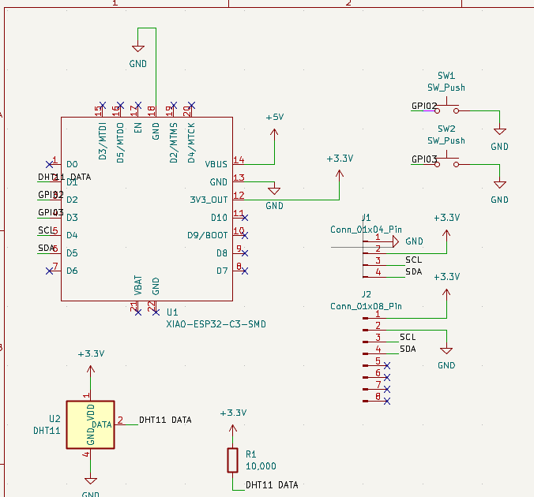

# Hack-Club-Half-Life-Starbie
My files for Half-Life week 1.

This is my pcb design for the tamagochi-esque project. It should read temperature and movement to create responses, which can be interacted with using buttons.

Here is the schematic screenshot. The DHT11 is my sensor, and the nets are labelled rather than connected by visual wires.
